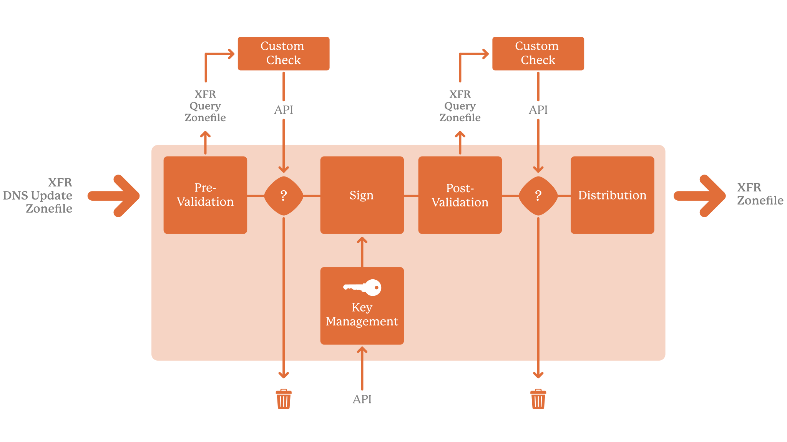

Architecture
============

Cascade's core pipeline runs in a single :program:`cascaded` daemon. Within
that process, separate components load zones, coordinate key management, sign
and review zone versions, persist approved data, and serve published zones.

Cascade has two separate models of operation going on at once:

#. Active units that respond to external input (DNS query, XFR, CLI command)
   or act on a timer basis; and
#. Passive per-zone pipelines whose current state determines what is or isn't
   allowed to happen next.

Each zone has its own state machine. A zone advances through one pipeline
operation at a time, while Cascade can perform work for different zones
concurrently. The currently published version remains available while a newer
version is loaded, reviewed, signed, and persisted.

The Zone Pipeline
-----------------

A zone version moves through the following stages:

#. **Load:** Cascade loads an unsigned zone from a local file or retrieves it
   from an upstream primary using AXFR or IXFR.
#. **Review the unsigned zone:** Depending on policy, Cascade proceeds
   automatically, waits for manual approval, or runs an operator-provided
   review hook.
#. **Persist the unsigned zone:** Cascade writes approved input data to disk
   before sending it to the signer.
#. **Sign:** The key manager determines the required DNSSEC key state and the
   signer creates the corresponding DNSSEC records and signatures.
#. **Review the signed zone:** Cascade can apply a second automatic or manual
   review before publication.
#. **Persist and publish:** Cascade persists the approved signed data and then
   makes that version available to downstream nameservers over AXFR and IXFR.
   It can send NOTIFY messages to configured downstream servers.

   An unsigned zone passes through optional review stages before and after
   signing. Only an approved signed version becomes the published version.

Flexible Signing
----------------

Cascade does not require a :term:`Hardware security module (HSM)` to operate.
Cascade is able to use `OpenSSL <https://www.openssl.org>`_ and `ring
<https://crates.io/crates/ring/>`_ software cryptography to generate signing
keys and to cryptographically sign DNS :term:`RRset <Resource Record Set
(RRset)>` data, storing the generated keys in on-disk files.

For operators wishing to use an HSM, Cascade can connect directly
to KMIP compatible HSMs, or to PKCS#11 compatible HSMs via our
:program:`cascade-hsm-bridge` daemon, which is installed automatically as part
of our Cascade packages.

.. hint:: Separating the main Cascade and cascade-hsm-bridge daemons avoids
   running  untrusted third-party code inside the main Cascade process. This
   eliminates a source of potential instability and unpredictable behaviour,
   as well as limiting resource usage.

Bespoke Zone Verification
-------------------------

Using :doc:`review-hooks`, Cascade supports optional verification of your
zone data at two critical stages: verification of the unsigned zone, and
verification of the signed zone. In both cases verification consists of
executing an operator supplied script or application which can verify the
zone using whatever mechanisms are required to satisfy your policy.

Verification of the zone can be done by retrieving it using the :term:`zone
transfer <Zone transfer>` protocol from dedicated "review" nameservers within
Cascade, either verifying the zone directly or writing the zone to disk for
verification by tools that only support working with files.

On completion of the verification process, approval or rejection is signalled
back to Cascade via the script exit code.

Rejecting a zone "soft" halts the Cascade pipeline for the zone, preventing it
from cascading further down the pipeline, but allowing a newer version of the
zone to be completely processed (unless that too should fail verification).

Serious errors in the pipeline may result in a "hard" halt for the pipeline
of a zone, preventing any further processing of that zone for the current and
future versions until an operator manually resumes the pipeline.

Managing State
--------------

Cascade stores its state in on-disk files in JSON format, by default at
various locations under a single parent directory. No additional database
software is required. As such, state is human-readable and easily backed up.
Note however, that state files are not intended to be modified by the user.

Some configuration is done via the Cascade command line interface (CLI), such
as adding zones and HSMs. Other configuration is done by editing policy and
application configuration files and instructing the Cascade daemon via the
CLI to reload them.

The Cascade daemon updates its on-disk state files periodically, and when
signalled to stop, reloading them on next start.

As Cascade outsources PKCS#11 support to :program:`cascade-hsm-bridge`,
it does not require access to related configuration files or other vendor
specific module dependencies.

Robustness
----------

Cascade is written in the Rust programming language making it significantly
less likely to crash or suffer from memory safety issues, and at the same
time making it easier to leverage the higher core count of modern computers
via Rust's "`fearless concurrency
<https://doc.rust-lang.org/book/ch16-00-concurrency.html>`_" when needed.
