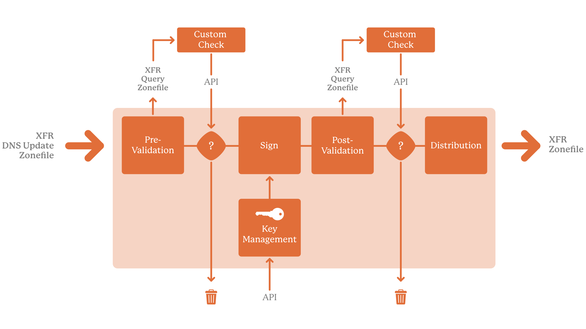

##############
 Threat Model
##############

Cascade is a DNS Security Extensions (:doc:`DNSSEC <intro>`) signing solution
that is meant to be integrated into a :term:`zone` publication pipeline. It is
meant to run as a "hidden signer", a dedicated server with restricted access
that takes local zone files or zones received over the network from an
upstream :term:`primary nameserver`, signs those zones and makes the results
available to downstream, Internet facing :term:`secondary nameservers
<secondary nameserver>`.

The Domain Name System (DNS) is a globally distributed hierarchical lookup
system which serves data associated to a domain name. DNS Security Extensions
(DNSSEC) protect end users against forged or modified DNS responses, both
deliberate and accidental, by digitally signing DNS record data to allow its
authenticity to be verified.

The zone data Cascade retrieves from the primary nameserver, as well as any
potential Hardware Security Modules (HSM) are trusted. Trust can be
established by cryptographic signatures through Transaction Signature (TSIG)
keys, network segmentation, etc.

We have created a threat model for Cascade [#f1]_, where we outline the
assumptions of the system that Cascade runs on, and the guarantees
Cascade provides given that those assumptions are met.

*********************************
 Goals, Assumptions & Guarantees
*********************************

Cascade should:

- Retrieve zone data from an upstream nameserver in a reasonable time
- Parse zone data correctly and in a reasonable time
- Re-sign zones often enough to maintain the freshness of signatures

-------------------
General assumptions
-------------------

- The user uses authentic copies of :program:`cascade(d)`, :program:`dnst`.
- An adversary does not have local user access to the host machine Cascade
  runs on.
- An adversary does not have access to key material (KSK/ZSK/CSK/TSIG).

- Key material is protected from unauthorized access, including command-line
  history and backup processes.

- The host machine Cascade runs on has enough resources (compute, memory,
  disk, network) for Cascade to function, including during the execution of
  user-supplied review hooks.

------------------------------
Assumptions on input zone data
------------------------------

- Input zone contents as received by Cascade are assumed to be what the
  operators wants signed,
- Input zone contents are well-formed and suitable for DNSSEC signing (e.g.
  free of NSEC3 collisions).

---
HSM
---

Cascade, if configured to use an HSM, relies on a correctly functioning KMIP server. Correctly functioning includes a reasonable response time and sufficient signing capacity for the signing workload. See the threat model of the cascade-hsm-bridge which can provide this functionality in combination with a vendor pckcs#11 library.

---------------------
Remote-control server
---------------------

An adversary does not have access to the remote-control server endpoint. By default, it listens on localhost only. When exposing the server to the network, compensating measures outside of Cascade are required.

-------------
Review server
-------------

An adversary does not have access to the review server endpoint. By default, it listens on localhost only. When exposing the server to the network, compensating measures outside of Cascade are required.

---------------------
Review hook execution
---------------------

- User-supplied review hooks terminate in a reasonable time.
- User-supplied review hooks code are not under control of the attacker.

------------------
Publication server
------------------

An adversary does not have access to the publication server endpoint. By default, it listens on localhost only. When exposing the server to the network, compensating measures outside of Cascade are required.

================================
Cascade guarantees the following
================================

- TSIG signed inputs are validated to detect tampering and rejected if invalid.
- Cacade's output is a correct 'signed zone' (See Section 10 in :RFC:`9499`) TODO: get wording from def.
- Cascade's per-zone pipelines are independent while load is under signing capacity.
- Cascade does not crash.
- Cascade publishes refreshed signatures early enough for propagation into caches.

.. rubric:: Footnotes

.. [#f1]

   Based on the `threat model for restic
   <https://github.com/restic/restic/blob/master/doc/design.rst#threat-model>`_.
